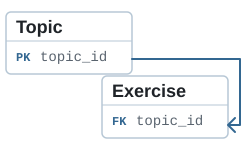
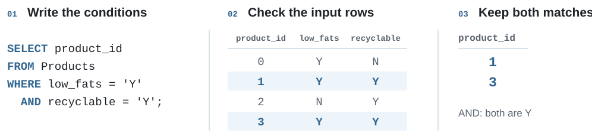
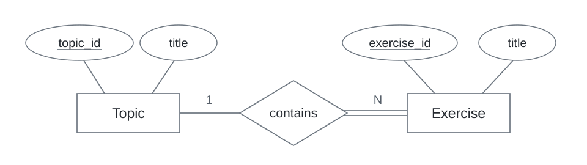
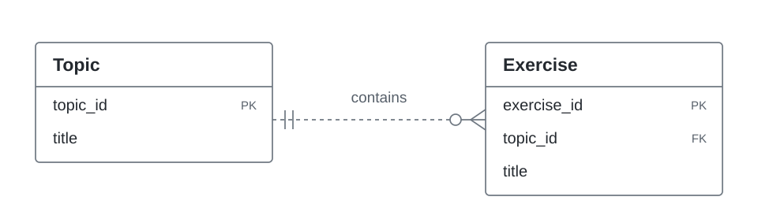

<h1 id="sql_lab">
  <a id="top"></a>
  <a href="https://www.postgresql.org/"></a>
  <picture>
    <source media="(prefers-color-scheme: dark)" srcset="assets/readme/sql-title-dark.svg">
    
  </picture>
</h1>

**SQL queries, relational design, and the notes I come back to.**

I keep my database practice here as part of my **Java/Spring Boot backend learning**. PostgreSQL is my working database: a place to write queries, check what they return, and understand the data behind an application.

**Recorded work:** [1 environment exercise](learning/postgresql/01_fundamentals/01_environment.sql) · [4 LeetCode SQL solutions](practice/leetcode-sql-50/01_select/)

<p>
  <a href="#learning-map">Learning&nbsp;map</a> &nbsp;·&nbsp;
  <a href="#queries-and-practice">Queries&nbsp;&amp;&nbsp;practice</a> &nbsp;·&nbsp;
  <a href="#working-setup">Use&nbsp;the&nbsp;lab</a> &nbsp;·&nbsp;
  <a href="#connected-labs">Connected&nbsp;labs</a>
</p>

<h2 id="learning-map">
  <a id="progress"></a>
  <picture>
    <source media="(prefers-color-scheme: dark)" srcset="assets/readme/relations-dark.svg">
    
  </picture>
  SQL learning map
</h2>

From reading rows to designing tables and understanding query plans. **Linked entries open recorded work; the remaining topics are still to add.** The saved [SQL roadmap](resources/sql-roadmap.pdf) is my broader reference.

<details>
<summary><strong>01 · Environment and query fundamentals</strong></summary>

- [Connection context and expressions](learning/postgresql/01_fundamentals/01_environment.sql) — database, role, schema, and arithmetic with `SELECT`.
- [Filtering practice](practice/leetcode-sql-50/01_select/) — `WHERE`, `AND`, `OR`, `IS NULL`, and `LENGTH`.
- Data types, casts, aliases, sorting, `DISTINCT`, and `LIMIT`.
- Boolean conditions, operator precedence, and how `NULL` affects comparisons.

</details>

<details>
<summary><strong>02 · Relationships and schema design</strong></summary>

- Entities, attributes, candidate keys, primary keys, and foreign keys.
- One-to-one, one-to-many, and many-to-many relationships.
- Chen ER, relational ERD, EER, and translating a model into tables.
- Normalization, constraints, and the tradeoffs behind a schema.
- Inner, outer, and self joins; unmatched rows and accidental duplicates.

</details>

<details>
<summary><strong>03 · Aggregation and multi-step queries</strong></summary>

- Aggregate functions, `GROUP BY`, and `HAVING`.
- Subqueries, correlated queries, `EXISTS`, and set operations.
- CTEs for readable intermediate steps.
- Window functions for ranking, running totals, and comparisons across rows.

</details>

<details>
<summary><strong>04 · Data changes and integrity</strong></summary>

- `CREATE`, `ALTER`, `INSERT`, `UPDATE`, and `DELETE`.
- Defaults, identity columns, uniqueness, and referential integrity.
- Transactions, `COMMIT`, `ROLLBACK`, and savepoints.
- Isolation, concurrent updates, and the mistakes a constraint can prevent.

</details>

<details>
<summary><strong>05 · Performance and application work</strong></summary>

- Indexes, `EXPLAIN`, execution plans, and measured query comparisons.
- Views and PostgreSQL functions.
- Parameterized queries through JDBC, then persistence with Spring Boot.
- Schema migrations and transaction boundaries in an application.

Java + Spring Boot + PostgreSQL is the direction I'm working towards. Application integration is still ahead of the SQL exercises here.

</details>

<h2 id="queries-and-practice"><a id="lab-record"></a>Queries &amp; practice</h2>

The current files are small, focused exercises. Each keeps its purpose or problem link beside the SQL so I can revisit the reasoning, change a condition, and check an edge case.

| Entry | What I practise |
| :--- | :--- |
| [**01 · PostgreSQL environment**](learning/postgresql/01_fundamentals/01_environment.sql) | Five read-only statements: connection context and arithmetic. |
| [**1757 · Recyclable and Low Fat Products**](practice/leetcode-sql-50/01_select/1757_recyclable_and_low_fat_products.sql) | Keep rows where both conditions hold — `AND`. |
| [**595 · Big Countries**](practice/leetcode-sql-50/01_select/0595_big_countries.sql) | Match either threshold — `OR`. |
| [**584 · Find Customer Referee**](practice/leetcode-sql-50/01_select/0584_find_customer_referee.sql) | Exclude one referee and retain missing values — `IS NULL`. |
| [**1683 · Invalid Tweets**](practice/leetcode-sql-50/01_select/1683_invalid_tweets.sql) | Filter text by character count — `LENGTH`. |

<picture>
  <source media="(prefers-color-scheme: dark) and (max-width: 600px)" srcset="assets/readme/filter-mobile-dark.svg">
  <source media="(max-width: 600px)" srcset="assets/readme/filter-mobile-light.svg">
  <source media="(prefers-color-scheme: dark)" srcset="assets/readme/filter-dark.svg">
  
</picture>

<p><sub>A worked illustration of the saved 1757 query, using sample rows. Result order is unspecified without <code>ORDER BY</code>.</sub></p>

<details>
<summary><a id="revision-index"></a><strong>Revision checks</strong></summary>

- **Environment:** explain what database, role, and schema mean before running the file again.
- **AND / OR:** identify which rows change when I switch the operator or add parentheses.
- **Missing values:** explain why `referee_id <> 2` alone drops rows with a `NULL` referee.
- **Boundaries:** test the exact area, population, or text-length threshold as well as values on either side.

LeetCode supplies the problem tables. Use the problem link in each file with its PostgreSQL editor; the environment exercise does not create those tables. HackerRank practice is still to add.

</details>

<details>
<summary><a id="schema-sketchbook"></a><strong>Schema sketchbook · one model, two views</strong></summary>

These are **conceptual README sketches**, separate from the runnable exercises. A topic contains exercises; each exercise belongs to one topic.

<picture>
  <source media="(prefers-color-scheme: dark) and (max-width: 600px)" srcset="assets/chen-mobile-dark.svg">
  <source media="(max-width: 600px)" srcset="assets/chen-mobile-light.svg">
  <source media="(prefers-color-scheme: dark)" srcset="assets/chen-dark.svg">
  
</picture>

<picture>
  <source media="(prefers-color-scheme: dark) and (max-width: 600px)" srcset="assets/erd-mobile-dark.svg">
  <source media="(max-width: 600px)" srcset="assets/erd-mobile-light.svg">
  <source media="(prefers-color-scheme: dark)" srcset="assets/erd-dark.svg">
  
</picture>

The first view describes the relationship; the second shows the tables and foreign key. Neither is an implemented schema in this lab yet.

</details>

<h2 id="working-setup">Working with the lab</h2>

**PostgreSQL · DataGrip · VS Code · Git**

I use DataGrip for queries, VS Code for repository files and notes, and Git to keep attempts and corrections. The [PostgreSQL setup guide](learning/postgresql/README.md) covers both DataGrip and `psql`, with expected results for the first exercise.

<details>
<summary><strong>Setup and first run</strong></summary>

Have a running PostgreSQL server and an existing practice database. Then clone the lab:

```sh
git clone https://github.com/codewithmahad/SQL_LAB.git
cd SQL_LAB
```

In DataGrip, open [01_environment.sql](learning/postgresql/01_fundamentals/01_environment.sql), select your database connection, and run one statement at a time with `Ctrl+Enter`. It reads session information and evaluates expressions; it needs no sample tables.

For `psql`, replace each `YOUR_...` value with your connection details and run from the repository root:

```sh
psql -X --set=ON_ERROR_STOP=on -h "YOUR_HOST" -p "YOUR_PORT" -U "YOUR_ROLE" -d "YOUR_DATABASE" -f "learning/postgresql/01_fundamentals/01_environment.sql"
```

The first three results depend on the connection. The arithmetic results are **30** and **5300**. Enter a password if prompted; keep credentials out of repository files.

**Connection refused?** Check that the server is running and the host and port match. **Authentication failed?** Check the role, password, and server authentication settings.

</details>

<details>
<summary><strong>Repository layout and references</strong></summary>

- **[learning/postgresql/](learning/postgresql/)** — fundamentals and the setup guide.
- **[practice/leetcode-sql-50/](practice/leetcode-sql-50/)** — saved problem solutions, grouped by topic.
- **[resources/](resources/)** — the saved SQL roadmap.
- **[assets/](assets/README.md)** — README artwork, source generators, and credits.

**PostgreSQL:** [Tutorial](https://www.postgresql.org/docs/current/tutorial.html) · [SQL reference](https://www.postgresql.org/docs/current/sql.html) · [Session functions](https://www.postgresql.org/docs/current/functions-info.html) · [psql](https://www.postgresql.org/docs/current/app-psql.html).

**Practice:** [LeetCode SQL 50](https://leetcode.com/studyplan/top-sql-50/) · [HackerRank SQL](https://www.hackerrank.com/domains/sql). **DataGrip:** [Run queries](https://www.jetbrains.com/help/datagrip/run-a-query.html).

</details>

Found a mistake? [Open an issue](https://github.com/codewithmahad/SQL_LAB/issues) with the file, query, and result.

<!-- learning-labs:start -->
<p id="connected-labs" role="heading" aria-level="2"><a id="backend-foundations"></a><strong>How the labs fit together</strong></p>

<p>
This lab covers the database side of my backend learning: writing queries, designing relational models, and understanding PostgreSQL.
I work through Java concepts in&#8239;<a href="https://github.com/codewithmahad/JAVA_LAB"><picture><source media="(prefers-color-scheme: dark)" srcset="assets/readme/labs/java-dark.svg"></picture></a>, practise algorithms in&#8239;<a href="https://github.com/codewithmahad/DSA_LAB"><picture><source media="(prefers-color-scheme: dark)" srcset="assets/readme/labs/dsa-dark.svg"></picture></a>, and keep my Linux and Bash coursework notes in&#8239;<a href="https://github.com/codewithmahad/LINUX_LAB"><picture><source media="(prefers-color-scheme: dark)" srcset="assets/readme/labs/linux-dark.svg"></picture></a>.
</p>

<p>
  <a href="https://leetcode.com/u/mahad2006/"></a>
  <a href="https://www.hackerrank.com/codewithmahad"></a>
  <a href="https://codolio.com/profile/codewithmahad"></a>
</p>
<!-- learning-labs:end -->

<hr>

<p align="center">
  <sub>
    Maintained by <a href="https://github.com/codewithmahad">Shaikh Mahad</a>
    &nbsp;·&nbsp; <a href="https://shaikhmahad.vercel.app/">Portfolio</a>
    &nbsp;·&nbsp; <a href="assets/README.md">Artwork credits</a>
    &nbsp;·&nbsp; <a href="#sql_lab">Back to top ↑</a>
  </sub>
</p>
