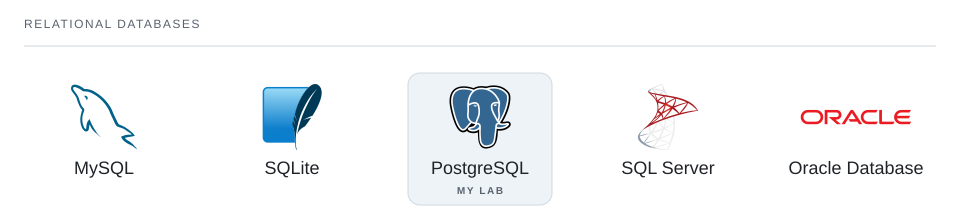
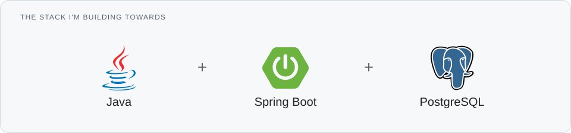
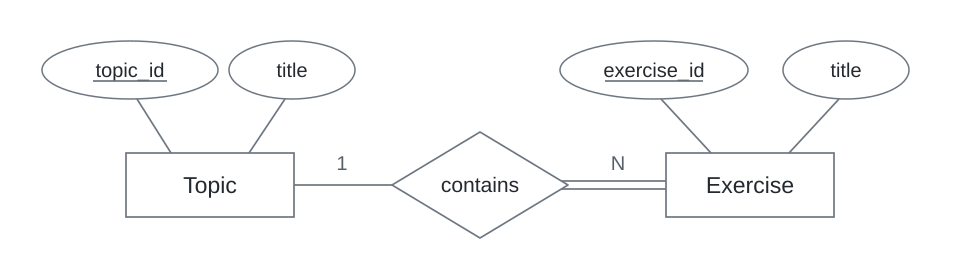
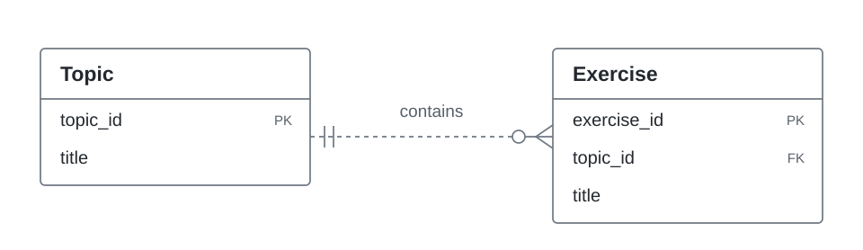
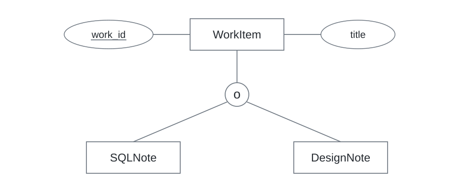

<a id="sql_lab"></a>

<div align="center">

<h1>SQL_LAB</h1>

**My SQL lab book.**

Queries, database models, practice attempts, and notes for the next time I need them.

[Lab record](#lab-record) &nbsp; / &nbsp; [Progress](#progress) &nbsp; / &nbsp; [Schema sketchbook](#schema-sketchbook) &nbsp; / &nbsp; [Revision index](#revision-index)

</div>

<br>

I'm **Shaikh Mahad**, a BS Software Engineering student at **UBIT, University of Karachi**, building towards backend development. This repository holds the database side of that work.

I use it to keep my SQL practice organised, track what I've covered, and find my own notes when I need to revise. Over time, I want the files and their history to show how my work improves: the queries I write, the models I design, and the decisions I can explain.

<br>

<a href="https://www.postgresql.org/"></a>

## Lab record

**Current focus · PostgreSQL fundamentals**

My recorded work covers the database environment, basic expressions, and four LeetCode filtering problems. This index points to the work already in the repository; I'll add entries as I study and practise more topics.

<br clear="right">

| Entry | Work recorded | File |
| :--- | :--- | :--- |
| **01 · Environment** | Database, role, schema, and arithmetic expressions. Five read-only statements. | [01_environment.sql](learning/postgresql/01_fundamentals/01_environment.sql) |
| **LeetCode 1757 · Recyclable and Low Fat Products** | Filter products with `WHERE` and `AND`. | [1757_recyclable_and_low_fat_products.sql](practice/leetcode-sql-50/01_select/1757_recyclable_and_low_fat_products.sql) |
| **LeetCode 595 · Big Countries** | Match either threshold with `OR`. | [0595_big_countries.sql](practice/leetcode-sql-50/01_select/0595_big_countries.sql) |
| **LeetCode 584 · Find Customer Referee** | Exclude a referee while retaining `NULL` values. | [0584_find_customer_referee.sql](practice/leetcode-sql-50/01_select/0584_find_customer_referee.sql) |
| **LeetCode 1683 · Invalid Tweets** | Filter by character count with `LENGTH`. | [1683_invalid_tweets.sql](practice/leetcode-sql-50/01_select/1683_invalid_tweets.sql) |

## Progress

**Recorded** means there's work in the repo to revisit. **Started** means some of the area is covered. **Planned** is still ahead of me.

| Area | Status | Coverage / next work |
| :--- | :--- | :--- |
| PostgreSQL environment | **Recorded** | Connection context and basic `SELECT` expressions. |
| Query fundamentals | **Started** | Recorded: `SELECT`, filtering, `AND`/`OR`, `NULL`, and `LENGTH`. Next: data types, sorting, and aggregates. |
| Relationships & modelling | Planned | Keys, joins, subqueries, Chen ER, relational ERD, and EER models. |
| Data integrity | Planned | Constraints, schema decisions, data changes, and transactions. |
| Advanced queries | Planned | CTEs, window functions, views, and PostgreSQL functions. |
| Performance | Planned | Indexes, `EXPLAIN`, execution plans, and query comparisons. |

**Practice:** Four LeetCode SQL 50 solutions are recorded under [SELECT practice](practice/leetcode-sql-50/01_select/). HackerRank SQL is still planned.

## Database choice

This lab is about **SQL and relational design**. PostgreSQL is where I put that work into practice; MySQL, SQLite, SQL Server, and Oracle are part of the wider database landscape.

<picture>
  <source media="(prefers-color-scheme: dark) and (max-width: 600px)" srcset="assets/databases-mobile-dark.svg">
  <source media="(prefers-color-scheme: dark)" srcset="assets/databases-dark.svg">
  <source media="(max-width: 600px)" srcset="assets/databases-mobile-light.svg">
  
</picture>

<details>
<summary><strong>Why I picked PostgreSQL for my Java + Spring Boot path</strong></summary>

<br>

<picture>
  <source media="(prefers-color-scheme: dark) and (max-width: 600px)" srcset="assets/backend-stack-mobile-dark.svg">
  <source media="(prefers-color-scheme: dark)" srcset="assets/backend-stack-dark.svg">
  <source media="(max-width: 600px)" srcset="assets/backend-stack-mobile-light.svg">
  
</picture>

I was looking for a modern, open-source database to learn and then use in my **Java + Spring Boot** projects. PostgreSQL was recommended to me for that path, so I chose it as the database for this lab.

The practical fit matters to me: PostgreSQL is [free and open source](https://www.postgresql.org/about/), [pgJDBC](https://jdbc.postgresql.org/) connects it to Java, and [Spring Boot supports SQL access through JDBC and JPA](https://docs.spring.io/spring-boot/reference/data/sql.html). I can keep using the same database as I move from standalone queries to application work.

For now, I'm learning the database itself. Later, I want to bring these queries and schema decisions into my own Spring Boot projects, with enough understanding to explain what happens behind a repository method. Performance is part of that learning too: indexes, query plans, and measuring the queries I actually write.

</details>

## Schema sketchbook

Database design belongs in this lab alongside the SQL. This is where I want to keep models, revisions, and the reasoning behind a schema.

<picture>
  <source media="(prefers-color-scheme: dark) and (max-width: 600px)" srcset="assets/chen-mobile-dark.svg">
  <source media="(prefers-color-scheme: dark)" srcset="assets/chen-dark.svg">
  <source media="(max-width: 600px)" srcset="assets/chen-mobile-light.svg">
  
</picture>

<sub>Lab-book concept sketch · Chen ER · topics and their exercises.</sub>

<details>
<summary><strong>Other modelling views · relational ERD & EER</strong></summary>

<br>

<picture>
  <source media="(prefers-color-scheme: dark) and (max-width: 600px)" srcset="assets/erd-mobile-dark.svg">
  <source media="(prefers-color-scheme: dark)" srcset="assets/erd-dark.svg">
  <source media="(max-width: 600px)" srcset="assets/erd-mobile-light.svg">
  
</picture>

<sub>Relational view · Topic and Exercise.</sub>

<br><br>

<picture>
  <source media="(prefers-color-scheme: dark) and (max-width: 600px)" srcset="assets/eer-mobile-dark.svg">
  <source media="(prefers-color-scheme: dark)" srcset="assets/eer-dark.svg">
  <source media="(max-width: 600px)" srcset="assets/eer-mobile-light.svg">
  
</picture>

<sub>Conceptual EER view · work items and study notes.</sub>

</details>

<br>

<a href="https://www.jetbrains.com/datagrip/"></a>

## Working setup

**PostgreSQL** is my main database, with **DataGrip** for SQL work and **VS Code** for repository files and notes. **Git** keeps the history as I add, revisit, and improve entries.

Learning files live under `learning/postgresql/`, with the saved roadmap under `resources/`.

<br clear="right">

<details>
<summary><strong>Repository layout</strong></summary>

```text
SQL_LAB/
├── learning/
│   └── postgresql/
│       └── 01_fundamentals/
│           └── 01_environment.sql
├── practice/
│   └── leetcode-sql-50/
│       └── 01_select/
│           ├── 1757_recyclable_and_low_fat_products.sql
│           ├── 0595_big_countries.sql
│           ├── 0584_find_customer_referee.sql
│           └── 1683_invalid_tweets.sql
├── resources/
│   └── sql-roadmap.pdf
├── assets/                         # README diagrams and logos
└── README.md                       # Lab index and progress
```

</details>

<br>

<a href="https://code.visualstudio.com/"></a>

## Revision index

The shortcuts I want when I come back to a topic. As the lab grows, this will link to my worked examples, corrections, and notes from earlier attempts.

**Next revision:** revisit the environment exercise and check that I can explain each result without the comments.

<br clear="right">

| Looking for | Reference |
| :--- | :--- |
| My environment & expression work | [Environment entry](learning/postgresql/01_fundamentals/01_environment.sql) |
| My LeetCode filtering solutions | [SELECT practice](practice/leetcode-sql-50/01_select/) |
| My study roadmap | [SQL roadmap PDF](resources/sql-roadmap.pdf) |
| PostgreSQL syntax & behaviour | [SQL reference](https://www.postgresql.org/docs/current/sql.html) |
| Database, role & schema functions | [Session information functions](https://www.postgresql.org/docs/current/functions-info.html) |
| Problem sets | [LeetCode SQL 50](https://leetcode.com/studyplan/top-sql-50/) · [HackerRank SQL](https://www.hackerrank.com/domains/sql) |

<br>

<a href="https://git-scm.com/"></a>

## Beyond the lab

If something here is useful for your own revision, use it as a reference. Corrections are welcome through an [issue](https://github.com/codewithmahad/SQL_LAB/issues) or pull request.

[**More of my work →**](https://github.com/codewithmahad?tab=repositories)

<br clear="right">

## Common connection errors

- **Connection refused:** Check that the PostgreSQL server is running and that the host and port are correct.
- **Password authentication failed:** Check the database username, password, and authentication configuration. Never include passwords in repository files.

<details>
<summary><code>-- a note to future me</code></summary>

```text
brain cache expired.
restoring from SQL_LAB...
```

</details>

<sub>Shaikh Mahad · BSSE, UBIT &nbsp; / &nbsp; <a href="assets/README.md">Artwork credits</a> &nbsp; / &nbsp; <a href="#sql_lab">Back to top ↑</a></sub>
